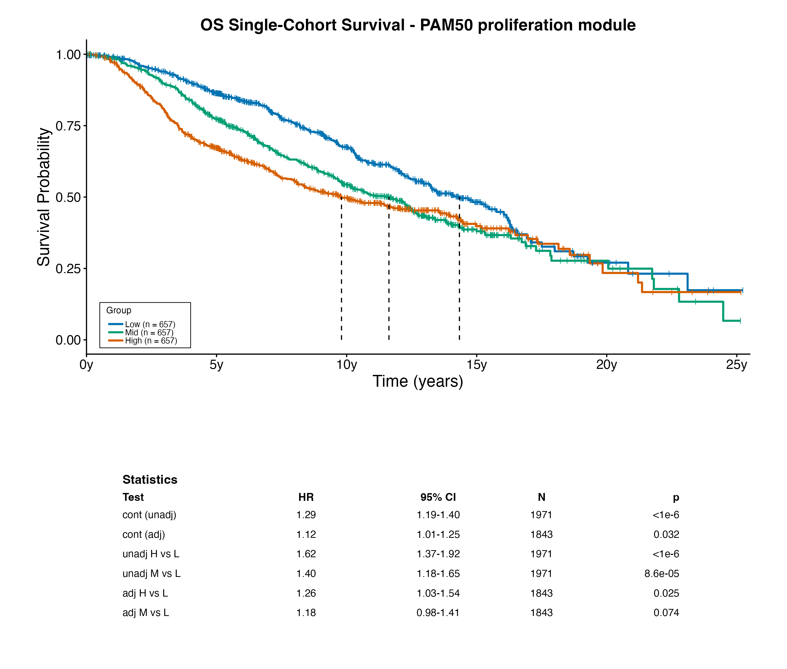
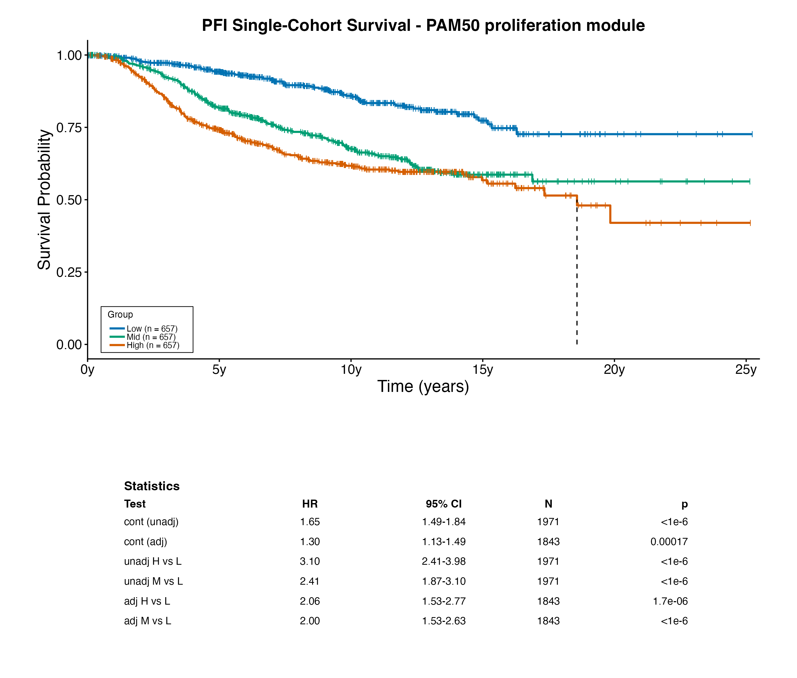
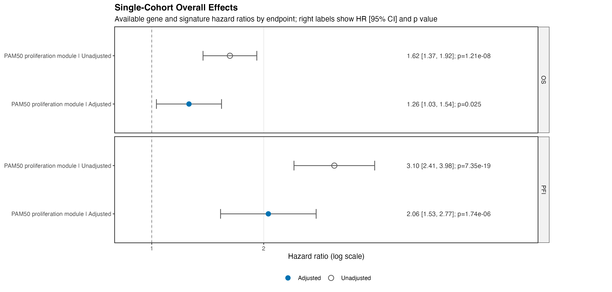
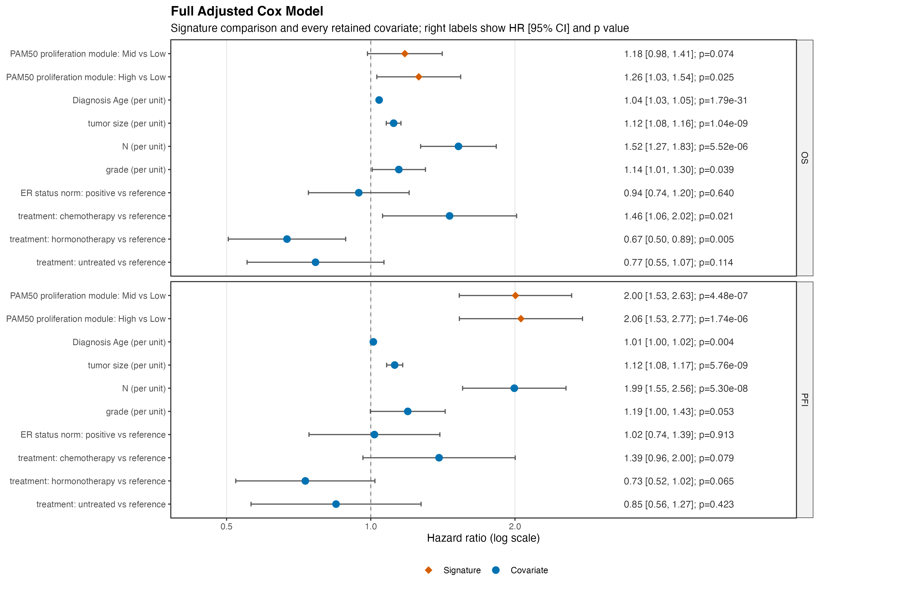

# Survival Signature Pipeline

An R command-line workflow for survival analysis of gene expression and expression signatures. It supports one prepared cohort, a declarative plan of adjusted/subgroup/interaction Cox models, and pooled analyses of two harmonized independent cohorts. All maintained workflows write run-scoped tables, figures, and provenance metadata.

## Features

- Continuous and grouped survival analysis for individual genes and z-scored expression signatures
- Kaplan-Meier plots and Cox models for a single cohort
- Declarative analysis plans for adjusted overall effects, filtered subgroup effects, and feature-by-group interaction tests
- Two-cohort piecewise Cox models for comparable, independently collected cohorts
- Generic forest plots from a shared subgroup-effect table
- Run metadata, input checksums, session information, and run-scoped output directories

## Quick Start

### Local R setup

The project lockfile targets R 4.5.1. Install `renv` once, then restore the project library from the repository root:

```bash
Rscript --vanilla -e 'if (!requireNamespace("renv", quietly = TRUE)) install.packages("renv", repos = "https://cloud.r-project.org"); renv::restore(project = getwd(), prompt = FALSE)'
```

Use the project runner for subsequent command-line runs. It selects the restored library and avoids a known noninteractive `renv` startup problem on some local systems:

```bash
./scripts/run_rscript_project.sh entrypoint.R --help
```

List every maintained workflow and its short description:

```bash
./scripts/run_rscript_project.sh entrypoint.R list
```

### Container setup

The same maintained CLI is available as a portable OCI image. Build the image locally, then run the containerized smoke test:

```bash
container/build_docker.sh survival-signature-pipeline:local
container/smoke_test.sh survival-signature-pipeline:local
```

The image is built for `linux/amd64`, matching the multi-gene-correlation container standard. It reads caller-provided files from `/data` and writes run artifacts to `/output`; see [the container contract](docs/container_contract.md) for a Docker invocation and integration boundary.

### Published image

The validated image is published to GitHub Container Registry (GHCR). For a
reproducible run, pull and launch it by immutable digest rather than by a
mutable tag:

```bash
docker pull ghcr.io/nidap-community/survival-signature-pipeline@sha256:a25e77f298eb602bf0a5e088a295cce783dd987baf23b7dada4d1cafea9ed35f
```

The corresponding source-revision tag is
`99cbdf1cfdcdb4ecf9c0ed5cbe4ac6ab996f7092`; it is provided for discovery,
while the digest above is the deployment identity. A Docker invocation should
bind caller-controlled inputs read-only at `/data` and a fresh output directory
at `/output`. The repository helper enforces that layout:

```bash
container/run_docker.sh \
  ghcr.io/nidap-community/survival-signature-pipeline@sha256:a25e77f298eb602bf0a5e088a295cce783dd987baf23b7dada4d1cafea9ed35f \
  /path/to/input_directory \
  /path/to/output_directory \
  single-cohort-survival \
  --expr-file /data/expression.tsv \
  --meta-file /data/metadata.csv \
  --features Signature \
  --signature-genes GENE1,GENE2 \
  --output-dir /output
```

HPC users may convert the same OCI image with Apptainer or Singularity. Test
the converted image in the target environment before using it for a production
job:

```bash
apptainer pull survival-signature-pipeline.sif \
  docker://ghcr.io/nidap-community/survival-signature-pipeline@sha256:a25e77f298eb602bf0a5e088a295cce783dd987baf23b7dada4d1cafea9ed35f
```

See [container/README.md](container/README.md) for the distribution model and
[the container contract](docs/container_contract.md) for the full runtime
interface. The repository's container-validation workflow runs an amd64 image
smoke test on pull requests and pushes to `main`; it validates but does not
publish images. A calling application should follow the [AWS adapter
contract](docs/aws_adapter_contract.md) for validated request handling, data
staging, and artifact collection.

## Example Output



This unweighted, 11-gene PAM50 proliferation-module demonstration in METABRIC
starts with the OS Kaplan-Meier display. It shows unadjusted low-, mid-, and
high-signature tertiles, censoring marks, group sizes, and a compact model
summary. Continuous-score estimates use all eligible samples.



The PFI display uses the same signature and tertile definition, so users can
review both standard endpoints before comparing their model summaries.

### Overall Effect Table

The compact table below reports the grouped high-versus-low-tertile comparison
for each endpoint. It complements, rather than replaces, the all-sample
continuous Cox estimates shown in the KM statistics panels.

| Endpoint | Model | Comparison | HR | 95% CI | p value |
| --- | --- | --- | ---: | --- | ---: |
| OS | Unadjusted | High vs Low | 1.623 | [1.374, 1.916] | 1.21e-08 |
| OS | Adjusted | High vs Low | 1.259 | [1.030, 1.540] | 0.025 |
| PFI | Unadjusted | High vs Low | 3.097 | [2.412, 3.975] | 7.35e-19 |
| PFI | Adjusted | High vs Low | 2.058 | [1.531, 2.767] | 1.74e-06 |



The overall forest plot is the visual counterpart to the endpoint table. It
summarizes unadjusted and covariate-adjusted high-versus-low signature effects
for OS and PFI.



The full adjusted-model forest then shows the signature's mid- and high-tertile
effects against the low-tertile reference, together with every retained
covariate coefficient for OS and PFI. These figures demonstrate the reporting
layout only; they are not an official PAM50 classifier or a clinical prediction
model. Review proportional-hazards and time-dependent diagnostic outputs before
interpreting a grouped KM contrast or forest plot.

## Input Files

### Expression matrix

Supply a tab-separated expression matrix with genes in rows and samples in columns. The gene-identifier column defaults to `Gene` and can be changed with `--gene-column`.

```text
Gene    Sample_1    Sample_2    Sample_3
GENE_A  1.2         0.8         1.5
GENE_B  2.1         1.9         2.4
```

### Metadata table

Supply a CSV metadata table with one row per sample. The sample identifier defaults to `sampnames` and can be changed with `--sample-column`. For standard endpoints, provide paired event/time columns:

```text
sampnames,OS,OS_time,PFI,PFI_time,Age,Group
Sample_1,1,18,1,12,55,Control
Sample_2,0,42,0,42,61,Treatment
```

`OS`/`OS_time` and `PFI`/`PFI_time` are the default endpoint mappings. Change them with the corresponding CLI flags. The analysis-plan workflow also allows a row to define any explicit `event_column` and `time_column` pair.

`single-cohort-survival` analyzes both `OS` and `PFI` by default (`--endpoints OS,PFI`). Pass `--endpoints OS` or `--endpoints PFI` only when intentionally restricting a run to one endpoint.

Prepare filtering and sample inclusion upstream. Maintained drivers analyze the rows supplied to them; they do not impose a tumor-type or sample-type filter.

### Gene identifiers

The maintained gene-consuming workflows can normalize user-supplied human gene symbols with the pinned `l2psupp::updategenes()` resolver (`--gene-resolution l2p`). This opt-in behavior leaves existing calls unchanged. The expression matrix is never renamed or rewritten. An exact input row is preferred; otherwise, an updated symbol is used only when it matches an existing expression row (in both matrices for a two-cohort workflow). Every run writes `tables/gene_identifier_resolution.csv`, preserving the submitted name, L2P result, package version, matched expression row, and any unresolved gene.

`--gene-resolution none` is the default for backward compatibility; use it when requested identifiers are already the intended expression-row identifiers. The run fails rather than dropping an unresolved requested gene or double-counting two inputs that resolve to the same row.

## Choose a Workflow

| Workflow | Use when |
| --- | --- |
| `single-cohort-survival` | You need grouped and continuous gene/signature survival analysis, Kaplan-Meier plots, and per-endpoint outputs for one cohort. |
| `single-cohort-analysis-plan` | You need a reproducible collection of adjusted overall effects, filtered subgroup effects, or formal feature-by-group interaction tests for one prepared cohort. |
| `subgroup-forest-bundle` | You already have a shared subgroup-effect summary table and need a forest plot. |
| `piecewise-dataset-interaction` | You have two harmonized, independent comparable cohorts and need pooled piecewise models with dataset interactions. |
| `piecewise-subtype-specific` | You have two harmonized cohorts and need pooled piecewise models within defined subgroup values. |
| `single-cohort-reporting-bundle` | You need reporting figures and tables from a completed `single-cohort-survival` run. |
| `finalized-pooled-results-bundle` | You need reporting figures and summary text from completed pooled result tables. |

Do not use the two-cohort workflows to represent biologically different disease states as though they were independent validation cohorts. Use a single-cohort analysis plan with explicit covariates, filters, and interaction axes instead.

## Run a Single-Cohort Analysis

This example runs the bundled smoke-test cohort through the maintained single-cohort workflow:

```bash
./scripts/run_rscript_project.sh entrypoint.R single-cohort-survival \
  --expr-file test_data/tcga_expression.tsv \
  --meta-file test_data/tcga_metadata_no_subtype.csv \
  --features GENE_D \
  --endpoints OS \
  --adjust-covariates none \
  --output-dir results/single_cohort_smoke
```

For a real run, make the feature, endpoint, covariate, and output choices explicit:

```bash
./scripts/run_rscript_project.sh entrypoint.R single-cohort-survival \
  --expr-file <expression.tsv> \
  --meta-file <metadata.csv> \
  --sample-column <sample_id_column> \
  --gene-column <gene_id_column> \
  --gene-resolution l2p \
  --features <gene_or_Signature> \
  --signature-genes <gene1,gene2,gene3> \
  --endpoints OS,PFI \
  --adjust-covariates <metadata_column1,metadata_column2> \
  --output-dir results/<run_name>
```

Use `--features Signature` only when `--signature-genes` supplies the feature members. To restrict an analysis to a metadata-defined group, add `--group-column <column>` and `--group-filter <value1,value2>`.

Signature genes are z-scored within the eligible cohort. The default score is their sum. The default Kaplan-Meier display uses low/mid/high tertiles, while continuous signature Cox models use **all eligible samples**; this preserves the full score information for the primary estimate even when a grouped plot is shown. Use `--signature-aggregation mean` when the analysis specification calls for an average score, or `--signature-continuous-cohort grouped` only when a deliberately group-restricted continuous analysis is required.

Use `--signature-label <display_label>` to give a signature plot a clear human-readable title without changing the score calculation.

### Complete analysis is the default

A normal run retains result objects, checks proportional-hazards assumptions,
and performs signature time-dependent analysis when indicated. Together with
the default `OS,PFI` endpoint set, these artifacts let users inspect the full
analysis rather than seeing only a Kaplan-Meier figure. Use the reporting
bundle after a completed run to add the overall forest plot.

For a rapid exploratory figure only, users may explicitly opt out with
`--run-ph-checks false --run-time-dependent false --save-results-rds false`.
That mode is not a substitute for the complete diagnostic run.

### Detectable versus undetectable genes

For an individual gene, use an explicit threshold:

```bash
./scripts/run_rscript_project.sh entrypoint.R single-cohort-survival \
  --expr-file <expression.tsv> \
  --meta-file <metadata.csv> \
  --features <gene> \
  --endpoints OS \
  --split-method detectable \
  --detection-threshold 0 \
  --include-groups Undetectable,Detectable \
  --adjust-covariates none \
  --output-dir results/<detectability_run>
```

This grouping is only available for individual genes, not `Signature`.

## Run a Declarative Analysis Plan

Use `single-cohort-analysis-plan` for a planned collection of continuous Cox models. Each CSV row describes an independent `overall`, `subgroup`, or `interaction` model; cohort-specific column names, filters, covariates, signature members, and interaction references live in the plan rather than in the code.

```bash
./scripts/run_rscript_project.sh entrypoint.R single-cohort-analysis-plan \
  --expr-file test_data/tcga_expression.tsv \
  --meta-file test_data/tcga_metadata.csv \
  --plan-file test_data/single_cohort_analysis_plan.csv \
  --output-dir results/analysis_plan_smoke
```

The required plan columns are:

| Column | Description |
| --- | --- |
| `analysis_id` | Unique identifier for the model row. |
| `analysis_type` | `overall`, `subgroup`, or `interaction`. |
| `feature` | Gene identifier, or display label for a signature. |
| `endpoint` | `OS` or `PFI`, or a custom label when explicit endpoint columns are included. |

See [the analysis-plan contract](docs/analysis_plan_contract.md) for the complete optional-column schema and output definitions.

## Run a Two-Cohort Analysis

Use the pooled workflows only with two independently collected, harmonized cohorts representing a comparable disease setting. Label the cohorts explicitly and supply all four input tables:

```bash
./scripts/run_rscript_project.sh entrypoint.R piecewise-dataset-interaction \
  --dataset1-expr-file <cohort_1_expression.tsv> \
  --dataset1-meta-file <cohort_1_metadata.csv> \
  --dataset1-label <cohort_1_name> \
  --dataset2-expr-file <cohort_2_expression.tsv> \
  --dataset2-meta-file <cohort_2_metadata.csv> \
  --dataset2-label <cohort_2_name> \
  --features Signature \
  --signature-genes <gene1,gene2,gene3> \
  --endpoints OS,PFI \
  --output-dir results/<pooled_run>
```

For subtype- or other stratum-specific pooled models, use `piecewise-subtype-specific --help` to review its required dataset-specific column flags and `--subtype-list` interface.

## Make a Forest Plot from Subgroup Results

All subgroup-producing workflows can emit or consume the shared summary columns below:

```text
subgroup, subgroup_type, feature, endpoint, comparison,
HR, CI_low, CI_high, p_value, p_value_bh
```

Create a generic forest plot from such a table:

```bash
./scripts/run_rscript_project.sh entrypoint.R subgroup-forest-bundle \
  --subgroup-summary-table <subgroup_effect_summary.csv> \
  --subgroup-type-filter <subgroup_type> \
  --output-dir results/<forest_run>
```

## Output Files

Each run writes to the specified `results/<run_name>/` directory and includes `RUN_METADATA.md` plus `logs/sessionInfo.txt`.

Typical analysis outputs include:

```text
results/<run_name>/
├── RUN_METADATA.md
├── logs/
│   └── sessionInfo.txt
├── tables/
│   ├── gene_identifier_resolution.csv          # submitted-to-expression gene mapping
│   ├── model_coefficients.csv                 # analysis-plan workflow
│   ├── subgroup_effect_summary.csv            # analysis-plan/subgroup workflows
│   └── ...
├── figures/                                   # reporting and forest workflows
└── OS/ or PFI/                                # single-cohort endpoint outputs
    ├── <endpoint>_summary.md                  # GitHub-rendered model tables, including covariates
    ├── adjusted_model_full_coefficients.csv
    ├── grouped_gene_cox_results.csv
    ├── results_univariate.csv
    └── <endpoint>_results.rds
```

Output names vary by workflow. Run `--help` before a new workflow and retain the corresponding `RUN_METADATA.md` with any result shared outside the repository.

### Overall forest plot for a single-cohort run

The single-cohort driver writes its endpoint analyses first. With its default `--save-results-rds true`, create an overall forest plot from that completed run with:

```bash
./scripts/run_rscript_project.sh entrypoint.R single-cohort-reporting-bundle \
  --input-run-dir results/<single_cohort_run> \
  --signature-label <display_label> \
  --output-dir results/<single_cohort_reporting_bundle>
```

This writes the primary-effect forest and its CSV/GitHub-rendered Markdown table under `tables/`. When the upstream run has a grouped adjusted signature model, it also writes the full adjusted-model forest and table:

- `figure1_single_cohort_overall_forest`: primary individual-gene and signature effects for each completed endpoint.
- `figure2_single_cohort_full_adjusted_model_forest`: the signature comparison and every retained covariate coefficient from each endpoint's grouped adjusted Cox model. Factor levels are labeled against their model reference level.

Use the normal analysis defaults when these reports are needed, rather than a figure-only run with `--save-results-rds false`.

## Help and Smoke Tests

Every maintained workflow provides workflow-specific help:

```bash
./scripts/run_rscript_project.sh entrypoint.R single-cohort-survival --help
./scripts/run_rscript_project.sh entrypoint.R single-cohort-analysis-plan --help
./scripts/run_rscript_project.sh entrypoint.R piecewise-dataset-interaction --help
```

The small files in `test_data/` are interface smoke-test fixtures only; they are not suitable for scientific interpretation. See [test_data/README.md](test_data/README.md) for the supported smoke-test commands.

## Requirements

- R 4.5.1 or a compatible R release
- The project library restored from `renv.lock`
- Tab-separated expression matrices and CSV metadata tables as described above

## Distribution and versioning

Use the published OCI digest for a reproducible deployment and retain it with
the run's `RUN_METADATA.md`. A formal semantic-version Git tag and GitHub
Release are intentionally deferred; when one is created, its notes and
versioned image reference will be recorded under [docs/releases/](docs/releases/).

## License

This project is available under the [MIT License](LICENSE).

## Support

Open an issue at [NIDAP-Community/survival-signature-pipeline](https://github.com/NIDAP-Community/survival-signature-pipeline/issues) for bugs, questions, or feature requests. Consult [docs/analysis_plan_contract.md](docs/analysis_plan_contract.md) for the detailed analysis-plan contract and [docs/architecture.md](docs/architecture.md) for development-oriented architecture notes.
